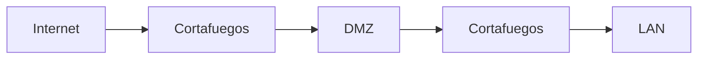

# Práctica 1 - Perímetro y zonas
Torrent S.L. quiere ordenar su red antes de abrir ningún acceso remoto. En esta práctica decides dónde va cada servicio y qué protocolo se usa en cada caso, y lo justificas.

## Minirreto 1: coloca cada servicio en su zona
**Zonas disponibles**
Zona | Confianza | Idea
-----|-----------|------
Internet | No confiable | Cualquiera, sin control
DMZ | Semiconfiable | Servicios expuestos a Internet, aislados de la LAN
LAN | Confiable | Usuarios y equipos propios
Zona crítica | Restringida | Archivos de alto valor con pocos accesos

Si un servicio no encaja en ninguna, créale una zona propia y defiende por qué.
**Servicios de Torrent**

Servicio | Zona | Justificación (una frase)
---------|------|----------------------
Web corporativa pública | DMZ | Debe estar disponible desde Internet sin comprometer la red interna
Servidor de correo | DMZ | Necesita intercambiar correos con Internet de forma segura
Pasarela VPN | DMZ | Actúa como punto de entrada cifrado para usuarios remotos antes de autenticarlos hacia la red interna
Proxy (saliente e inverso) | DMZ |  Filtra el tráfico web que entra hacia servicios internos y el que sale de los empleados hacia Internet
HMI de planta y carpeta de planos | Zona crítica | Son archivos muy controlados que debe ser accesible solo desde la LAN
Autoridad de certificación (srv-ca) | Zona crítica | Si se compromete la CA raíz, un atacante puede suplantar cualquier identidad o servicio
Servidor de copias de seguridad | Zona crítica | Debe estar aislado para vitar que un ataque de ransomware en LAN cifre o borre 
Portátiles de ingenieros y operarios | LAN | Son equipos corporativos gestionados por la empresa que necesitan acceder a recursos internos diarios
Wi-Fi de invitados | Zona invitados | Da salida a internet a dispositivos externos no confiables sin permitirles ver ni tocar la red
Servidor de registros y monitorización | LAN | Centraliza las auditorias de todas las zonas y debe protegerse contra manipulaciones o borrado de pruebas

**Tabla de flujos** Qué conexiones se permiten y cuáles no entre zonas:

Origen -> Destino | ¿Permitido? | Ejemplo concreto
-----------------|-------------|-----------------
Internet -> DMZ | Si | Un cliente externo accede a la web corporativa por HTTPS 
Internet -> LAN | No | La conexión entrante directa desde internet hacia los portátiles o servidores internos queda bloqueada por defecto, si una respuesta si se permite
DMZ -> LAN | Solo para lo imprescindible | VPN
LAN -> DMZ | Si | Los portátiles de los empleados navegan a través del proxy saliente o consultan su correo interno en el servidor
LAN -> Internet | Si, a través de un Proxy | Se bloquea la salida directa de los equipos; todo el trafico web debe pasar si o si por el proxy de la DMZ para ser filtrado

**Diagrama de la red** Puedes dibujarlo con el bloque de Mermaid de abajo o subir una imagen

